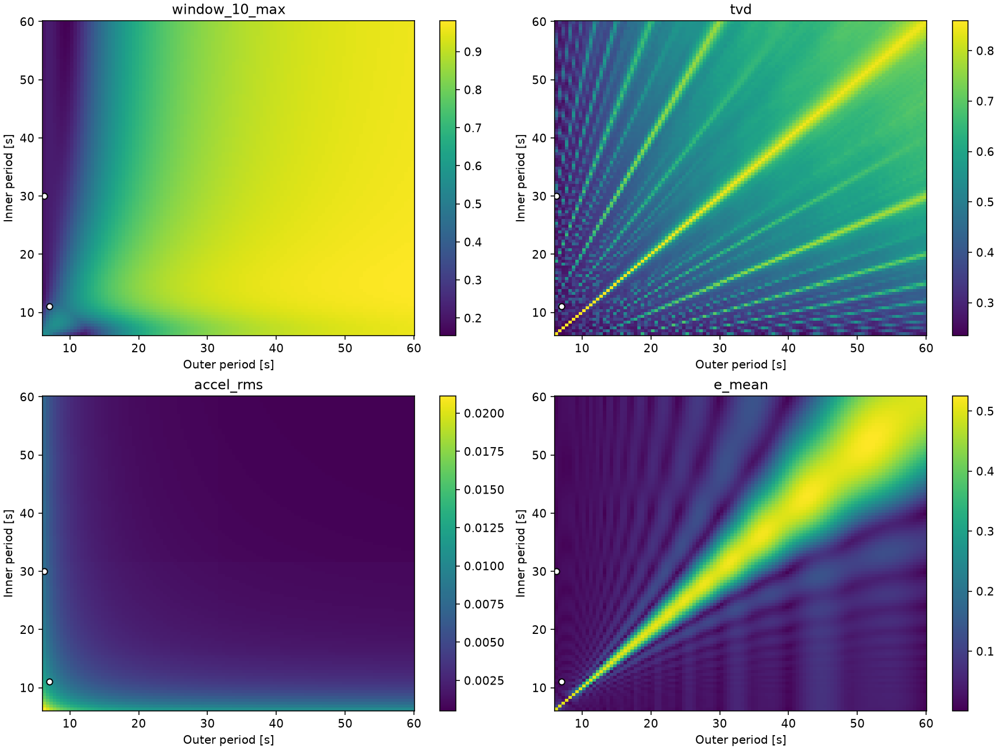

# 2軸RPM：回転周期の数学的探索

**研究の問い：適切に回転させることで、模擬微小重力環境を実現できるか？**

**結論：** 2軸の回転周期を適切に選ぶと、試料から見た重力ベクトルの**時間平均**を大幅に減らせることを数値計算で確認した。例えば、外枠7秒・内枠11秒から**6.3秒・30秒**に変えると、120秒間の平均重力方向ノルムは **0.01814 → 0.00258（約86%減）**となった。ただし**瞬間的な重力が小さくなるわけではない**。細胞への影響は実験による検証が必要である。

## 1. 数学モデルと評価指標

外枠をX軸、内枠をY軸に回転させ、角度をそれぞれ $\phi(t),\theta(t)$ とする。試料に固定した座標系での重力方向（長さ1）は、

$$
\mathbf u(t)=
\begin{pmatrix}
\cos\phi(t)\sin\theta(t)\\
-\sin\phi(t)\\
-\cos\phi(t)\cos\theta(t)
\end{pmatrix}.
$$

外枠・内枠の周期 $T_x,T_y$ に対する目標角速度は $\omega_x=2\pi/T_x$, $\omega_y=2\pi/T_y$。**初期角速度0**から起動し、速度上限 $1\,\mathrm{rad/s}$、加速度上限 $2\,\mathrm{rad/s^2}$ を守って計算した。

| 指標 | 定義 | 読み方 |
|---|---|---|
| **全期間平均偏差** $E$ | $\displaystyle \left\|\frac1L\int_0^L\mathbf u(t)\,dt\right\|$ | 実験時間 $L$ 全体で向きがどれほど打ち消されるか |
| **10秒窓最大偏差** $W_{10}$ | $\displaystyle \max_{10\le t\le L}\left\|\frac1{10}\int_{t-10}^t\mathbf u(s)\,ds\right\|$ | 途中の**どの10秒間**にも大きな偏りがないか |
| **球面方向分布のTVD** | $\displaystyle \frac{1}{2}\sum_{i=1}^{288}\lvert p_i-\frac{1}{288}\rvert$ | 球面288等面積区画への滞在割合 $p_i$ が均一か |
| **回転加速度RMS** | $\displaystyle \sqrt{\frac1L\int_0^L\|\mathbf a_{\mathrm{rot}}(t)\|^2dt}$ | 回転によって生じる加速度。試料座標X方向1 cmで算出 |

すべて**小さいほど良い**。$E,W_{10}$ は重力加速度 $g$ で正規化した無次元量。例えば $E=0.0026$ は**時間平均ベクトル**の大きさが $0.0026g$ 相当という意味で、瞬間的に $0.0026g$ になったという意味ではない。

## 2. 回転周期を格子探索

- **粗探索：11,883組**。外枠・内枠とも約6.3～60秒、主に0.5秒刻み。
- **詳細探索：粗探索と合わせて71,178組**。有望な周期の周辺を0.05秒刻みで追加探索。
- 基本条件：**120秒間、時間刻み0.1秒、探索用の初期姿勢3組**。代表候補は探索とは独立の**20初期姿勢**でも検証。
- 各指標について良好な領域が異なる。色の尺度は図ごとに異なる。

*図：横軸＝外枠周期、縦軸＝内枠周期。異なる指標の色をそのまま横断比較しない。*

## 3. 独立した20初期姿勢での比較

**120秒間・20試行の平均**。同じ評価条件で比較した。

| 外枠 / 内枠 | 全期間平均偏差 $E$ | TVD | 10秒窓最大 $W_{10}$ | 加速度RMS (m/s²) |
|---|---:|---:|---:|---:|
| 7秒 / 11秒（基準） | 0.01814 | 0.34176 | 0.36543 | 0.01111 |
| **6.3秒 / 30秒** | **0.00258** | 0.24756 | 0.20592 | 0.00800 |
| **9.4秒 / 60.3秒** | 0.01701 | 0.32016 | **0.15330** | **0.00351** |
| 7.1秒 / 7.55秒 | 0.00642 | **0.22735** | 0.53770 | 0.01559 |
| 60秒 / 30秒 | **0.00000310** | 0.77579 | 0.96810 | 0.00097 |

**重要な違い：** 60秒 / 30秒は全期間平均偏差がほぼゼロなのに、10秒窓最大偏差は約0.968、TVDは約0.776。つまり**「実験全体で平均すると小さい」と「実験途中の短時間でも小さい」は別の性質**である。

詳細探索（120秒・探索用3姿勢）では、全期間平均偏差の最良候補は**60秒 / 30秒**、TVDは**7.1秒 / 7.55秒**、10秒窓最大偏差は**9.4秒 / 60.3秒**だった。**どの指標を重視するかによって適切な周期が変わる**。

## 4. 結論と実験で確認したいこと

**数学モデル上では、回転周期の選択だけで重力方向の時間平均や短時間の偏りを改善できる。** 一方、各指標に共通する単一の最良周期は確認されなかった。実験で重視する時間スケールを決め、候補周期を実機で比較することが次の課題である。

補足：角速度を強化学習（PPO）で補正する方法も試したが、現時点では十分に探索した定速制御を上回ることは確認できていない。

**[公開3Dビューア](https://rpm-lab-viewer.lifeistechkei.chatgpt.site)**

## 公開データ

- [粗探索の指標別最良周期（CSV）](data/coarse_best_periods.csv)
- [詳細探索の指標別最良周期（CSV）](data/detail_best_periods.csv)
- [独立20姿勢・120秒の代表候補比較（CSV）](data/independent_120s.csv)
- [格子探索の設定（JSON）](data/constant-grid.json)

*このリポジトリの結果は運動学的シミュレーションに基づく。生物学的応答や流体の挙動を直接予測するものではない。探索は有限格子と有限時間に対する数値最適化であり、数学的な大域最適性を証明したものではない。*
